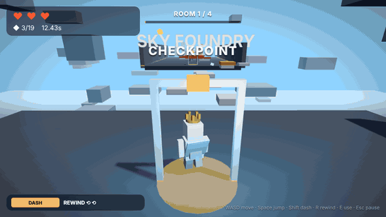
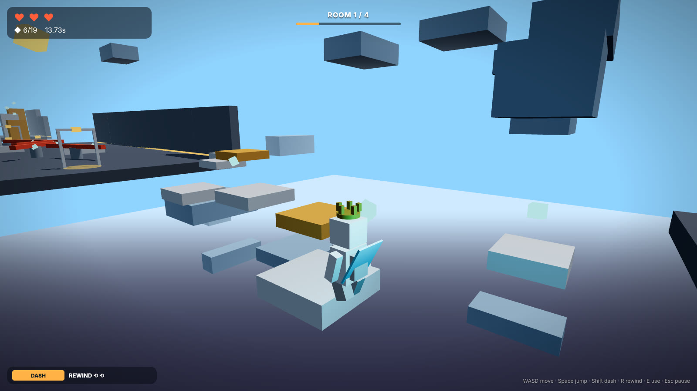
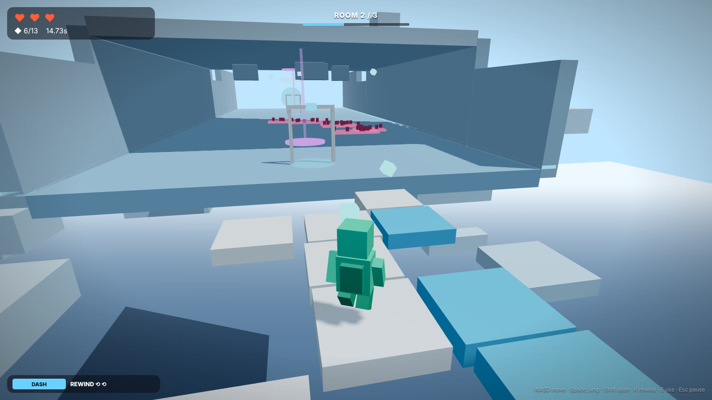
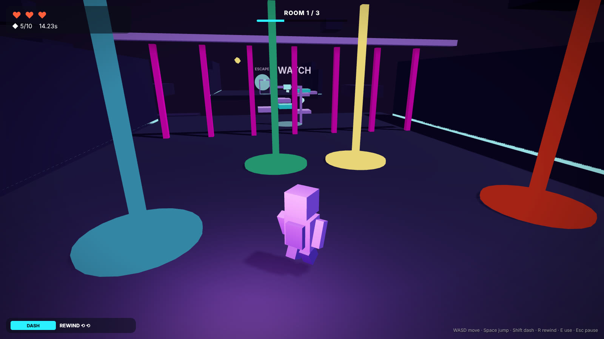
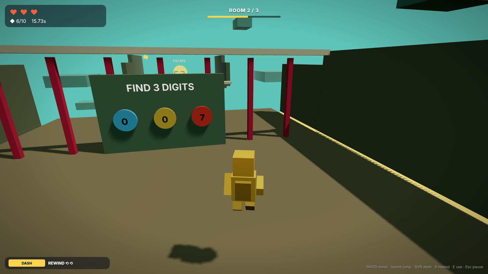
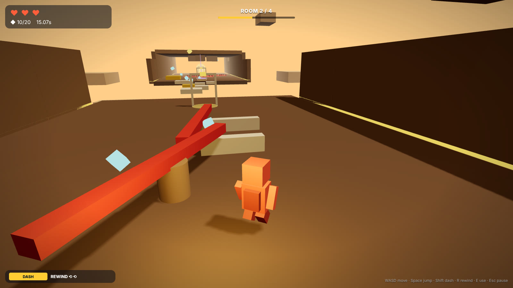
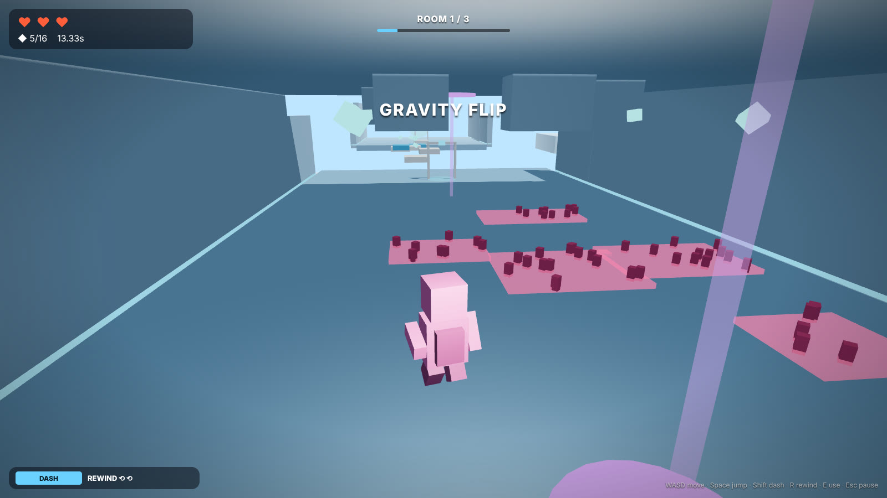
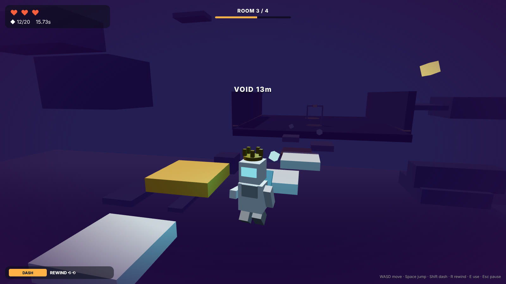
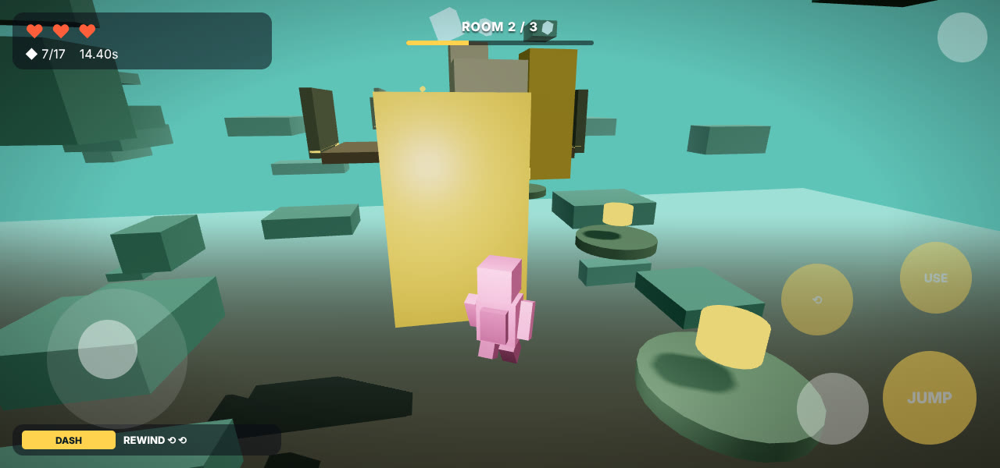

# 🌀 Shiftscape

[](https://jaking-studios.github.io/shiftscape/play/)
[](https://jaking-studios.github.io/shiftscape/downloads/Shiftscape.apk)
[](https://jaking-studios.github.io/shiftscape/downloads/Shiftscape-Windows.zip)
[](https://github.com/jaking-studios/shiftscape/actions/workflows/build.yml)

**Outrun the Void. Flip the world. Rewind your mistakes.**

<p align="center">
  
</p>

<p align="center">
  <a href="docs/media/shiftscape-preview.mp4"><b>▶ Watch the full-quality video (MP4)</b></a>
</p>

> **About the footage:** the GIF, video and screenshots below are *pre-visualization renders* produced from the game's level generator, palettes, avatar and HUD design (see [`tools/previs`](tools/previs)). They show the intended look of each world and room type. Real in-engine captures will replace them once the first Unity build is published.

## Screenshots

| | |
|:--:|:--:|
| <br>**Sky Foundry** — platform hops | <br>**Frost Observatory** — crumbling ice bridges |
| <br>**Neon Arcade** — memory pads | <br>**Sunken Temple** — code vault |
| <br>**Clockwork Spire** — spinner gauntlet | <br>**Gravity Hall** — flip pads |
| <br>**The Void** — right behind you | <br>**Mobile** — touch controls |

Shiftscape is an original 3D escape game built in **Unity 6 (6000.3)** for **browser (WebGL), Android and PC** (iOS exports too). Every run is a procedurally generated chain of rooms you have to get through before the Void — a creeping wall of nothing — catches you.

> Inspired by the feel of Roblox escape/obby games, but with its own mechanics: this is not a remake of any existing game.

## What makes it different

| Feature | What it does |
|---|---|
| **The Void** | A translucent wall chases you along every level. It *pauses in puzzle rooms* ("safe rooms"), so puzzles are about thinking, not panic. Calm mode slows it down. |
| **Gravity flips** | Flip pads invert gravity. You run on the ceiling past floor hazards, dodge stalactites, and flip back. The camera rolls with you. |
| **Rewind** | Hold `R` to scrub back the last 3 seconds of your own movement. 2 charges, refilled at each checkpoint (more with the Chrono Coil upgrade). |
| **Seeded worlds** | Levels are generated from a seed. Same seed → same level, which powers **Daily Shift** (one shared seed per day) and **Ghost Race** (race the translucent ghost of your best run). |
| **8 room types** | Platform Hop, Spinner Gauntlet, Crumble Bridge, Gravity Hall, Bounce Towers, and three puzzle rooms: Memory Pads (Simon-style), Code Vault (find 3 hidden digits, dial them in), Crate & Plate (push crates onto pressure plates). |
| **5 worlds** | Sky Foundry → Frost Observatory (icy grip) → Neon Arcade → Sunken Temple → Clockwork Spire. Unlocked with ★ stars. |
| **Stars** | 1 for escaping, +1 flawless (no hearts lost), +1 for collecting 80% of the Shards. |
| **Workshop** | Spend Shards on gadgets: Pulse Boots (double jump), Drift Cape (glide), Overclock (dash cooldown), Chrono Coil (+rewind), Shard Magnet, Spare Core (+heart). Earned only — nothing is sold for real money. |
| **Wardrobe** | 8 suits, 6 hats, 5 trails. Cosmetic only. |
| **10 achievements** | Each pays out Shards. |
| **Zero art assets** | Everything — geometry, materials, sounds, music — is generated at runtime from primitives and synthesized audio. The whole game is C#. |

## Controls

| | PC | Touch (phones/tablets) |
|---|---|---|
| Move | `WASD` / arrows | Floating joystick (left half) |
| Look | Mouse | Drag (right half) |
| Jump / glide | `Space` (hold to glide with Drift Cape) | **JUMP** |
| Dash | `Shift` or right-click | **DASH** |
| Rewind | hold `R` | hold **⟲** |
| Use (dials, levers) | `E` | **USE** |
| Pause | `Esc` / `P` | **II** |

Touch controls are automatic on mobile and can be forced on/off in Settings (handy for testing on PC: the mouse acts as a finger).

## Project layout

```
Assets/Shiftscape/Scripts/
  Core/      Bootstrap (auto-creates everything), GameManager (run flow, hearts, stars, daily, ghost),
             SaveSystem (JSON, swap for cloud), GameAudio (synthesized SFX + music), Mat (primitive/material factory)
  Data/      WorldTheme (ScriptableObject – add worlds without touching code), Catalog (upgrades, cosmetics, achievements)
  Input/     GameInput (keyboard/mouse + touch joystick & buttons, one API)
  Player/    PlayerMotor (gravity-direction-aware rigidbody controller, dash, double jump, glide, rewind),
             PlayerVisual (procedural avatar + animation + cosmetics), CameraRig
  World/     LevelBuilder (seeded room generator), Interactables (platforms, spinners, crumble tiles, bounce pads,
             flippers, checkpoints, shards, gates, FX pool), Puzzles, VoidWall
  UI/        UIK (DPI-aware IMGUI kit), GameUI (menu, worlds, workshop, wardrobe, settings, HUD, pause, results)
  Editor/    ProjectBuilder (player settings + one-click/headless builds for every platform)
Assets/Scenes/Main.unity   – intentionally empty; Bootstrap builds the game at runtime
.github/workflows/build.yml – cloud builds + GitHub Pages deploy
docs/                       – website (GitHub Pages): landing page, media, placeholder /play page
tools/previs/               – three.js pre-vis used to render the screenshots / GIF / video
```

### Adding content
* **New world:** `Assets ▸ Create ▸ Shiftscape ▸ World Theme`, save it under `Assets/Resources/Worlds/`, pick colours, grip, void speed and the room mix. It appears in the world list automatically. (Or add a line to `WorldCatalog.BuiltIn()`.)
* **New room type:** add a value to `RoomKind`, a `case` in `LevelBuilder.Build`, and a builder method. Rooms are just functions that place primitives along +Z.
* **New gadget/cosmetic/achievement:** add one line to the lists in `Catalog.cs`.

## Build it yourself

1. Install **Unity 6000.3.x** (Unity Hub) with the WebGL and/or Android modules.
2. Open the folder, open `Assets/Scenes/Main.unity`, press Play.
3. Menu **Shiftscape ▸ Build WebGL / Android APK / Android AAB / Windows / macOS / Linux / iOS**, or headless:
   ```
   Unity -batchmode -quit -projectPath . -executeMethod Shiftscape.EditorTools.ProjectBuilder.BuildWebGL
   ```
   Builds land in `Builds/`.

## Publishing (cloud builds via GitHub)

The workflow in `.github/workflows/build.yml` builds **WebGL, Android APK and Windows** on every push to `main`, deploys the WebGL build to **GitHub Pages** (`/play/`), and attaches the APK/zip to a **GitHub Release** when you push a tag like `v1.0.0`. Unity needs your own license for cloud builds — a one-time setup:

1. **Get your Unity license** by following the current [game.ci activation guide](https://game.ci/docs/github/activation) (the older `unity-request-activation-file` action has been retired, so use the steps on that page).
2. **Repo ▸ Settings ▸ Secrets and variables ▸ Actions**, add:
   * `UNITY_LICENSE` — paste the full contents of the `.ulf` file
   * `UNITY_EMAIL` — your Unity account email
   * `UNITY_PASSWORD` — your Unity account password
3. **Repo ▸ Settings ▸ Pages ▸ Source → "GitHub Actions"**.
4. Push (or run the workflow from the Actions tab). The website at `https://jaking-studios.github.io/shiftscape/` deploys on every push **even before you add the Unity secrets**; the playable WebGL build replaces the placeholder `/play/` page once a Unity build succeeds.

**Unity Play:** the project includes the WebGL Publisher package (`com.unity.connect.share`). In the Editor: **Publish ▸ WebGL Project ▸ Build and Publish** to put the same game on play.unity.com.

**Google Play:** build an AAB with **Shiftscape ▸ Build Android AAB**, sign it with your upload key in *Player Settings ▸ Publishing Settings*, and upload in Play Console. Package id `com.jakingstudios.shiftscape`.

**iOS:** **Shiftscape ▸ Export iOS Xcode project** on a Mac, then archive in Xcode.

## Tech notes
* Gravity is handled by `PlayerMotor` (not `Physics.gravity`) so "down" can point anywhere; the camera and avatar follow the player's up vector.
* Rewind stores 150 physics snapshots (3 s at 50 Hz) and plays them back at 2× — no extra memory per object.
* Materials come from two always-included shaders (Standard via Default-Material, Sprites/Default for glow) so WebGL/mobile builds never hit missing-shader issues.
* Saves are JSON in `Application.persistentDataPath` (IndexedDB on WebGL). `SaveSystem.Load/Save` are the only two places to touch for cloud saves.
* Target 60 fps on phones: no realtime shadows in *Fast* graphics mode, pooled FX, ~400 static primitives per level, linear fog hides the far end.

## License
MIT — see [LICENSE](LICENSE). "Shiftscape" and the JaKing Studios name belong to Jaineil Rana.

## Re-rendering the preview media
```
cd tools/previs
node render.js ./out        # needs Node + Playwright (chromium); writes stills + frames/
ffmpeg -framerate 30 -i out/frames/%05d.png -c:v libx264 -crf 22 -pix_fmt yuv420p preview.mp4
```
`scene.html?world=frost&mode=gravity&frame=40` renders any world/room combination in the browser. Worlds: `foundry frost neon temple spire`; modes: `hop spinner gravity memory vault void bounce crumble`.
